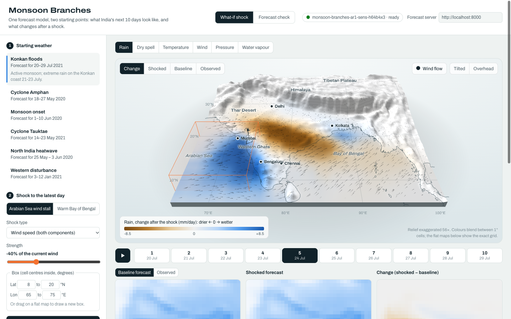
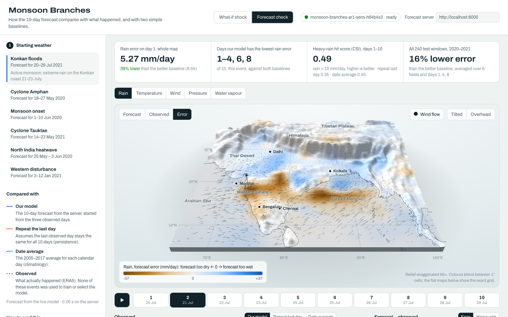

# Monsoon Branches

**Team intelligentapes · Multiverse of Monsoon · Yugaantar DevForge.** Forecast 10 days of weather over India and the surrounding seas from three
observed days, then show how a localised change to the starting weather alters rainfall and dry spells, and check that
response against how the real atmosphere has behaved.

> *If winds over the Arabian Sea weaken today, where does the model predict more or less rain over the next 10 days?*

- **Timeline Prime**: a residual CNN that corrects a climate-memory (AR(1)) forecast rolls the three supplied days forward
  one day at a time. Its shock responses are constrained to stay inside what ERA5 shows the real atmosphere doing.
- **Multiverse**: the same model runs again from a shocked start (a physical-unit change added to the latest day). The
  scenario response is the difference between the two rollouts.
- **Dashboard**: pick a held-out start, draw a box and set a shock. A 3D relief model of India (ERA5 terrain) carries the
  forecast, live wind flow and the shock box, and plays through the 10 days. Flat maps on the exact 1° grid compare the
  baseline, shocked and difference fields, with each land cell's 10-day rain and longest dry spell. A second view,
  **Forecast check**, puts the same forecast next to what happened and next to the grader's two baselines, day by day.

## Results

The model was chosen on 2018–2019 by a rule fixed before any result was seen (`scripts/finalize.py`), then scored on the
held-out years. The test years were scored twice. The first time was for an earlier version of the constraint, which kept
responses only inside the observed range. The second was for this version, which was added afterwards, chosen on
2018–2019 by the same rule, and is within 0.001 of the earlier version's test skill. Every number uses the official `monsoon_r1` scoring functions. Skill is 1 − RMSE ÷ RMSE of the better
of persistence and climatology, latitude-weighted, at leads 1, 4 and 8.

| | Tune 2018–19 | **Test 2020–21** | Test 2022 |
|---|---|---|---|
| Mean skill (full RMSE points at 0.12) | +0.175 | **+0.164** | +0.180 |
| Heavy-rain CSI skill (full points at 0.10) | +0.125 | **+0.122** | +0.135 |
| Day 4 beats persistence on every field | yes | **yes** (+0.28 at worst) | yes |
| Invalid outputs | 0 of 240 | **0 of 240** | 0 of 118 |
| Day-8 spatial variance ÷ observed (anti-blur needs ≥ 0.40) | 0.75–0.99 | **0.70–1.02** | 0.72–1.05 |
| Forecast points as graded: 5 random windows, mean / 10th percentile, of 45 | 43.3 / 38.6 | **42.4 / 35.8** | 43.9 / 40.5 |
| Shock causality points, of 15 | 13.3 | **13.4** | |

Expected automated score on 2020–2021: about **66 of 70** (42.4 forecast + 10 anti-blur + 13.4 shocks). Scoring all 240
windows at once gives 68.4. The shock points lost are the monsoon-stall "propagation" check: the response to a one-day
wind change fades before days 4–8 instead of spreading. Only 5 windows are graded, so a single badly forecast event moves the score by a few points.

- **Server:** the official schema validator passes every check. A 10-day request takes 0.07 s over HTTP on a laptop CPU
  (the limit is 5 s). The repo scan gives 15 of 15.
- **Fresh checkout:** a clean `git clone`, with a new virtual environment holding only `requirements.txt` (torch 2.15,
  numpy 2.5), no network and 4 threads:
  - the validator passes;
  - peak memory is 265 MB (the limit is 6 GB);
  - the forecasts match the development setup exactly.
- **Random shocks** (`scripts/fuzz_shocks.py`, 300 cases): any box from one cell to the whole map; wind −100% to +100%,
  temperature ±10 K, vapour −60% to +100%, pressure ±30 hPa, rain up to +200 mm/day, or several at once.
  - Every answer is valid.
  - The same request always returns the same answer.
  - Median 95% of day-1 response energy lies within 3 cells of the box.
  - The largest day 4–10 response exceeds 5 standard deviations in 3% of cases.

**Shocks beyond the official two** (`scripts/scenario_battery.py`; expected direction written down before running; 12
windows of the right season in 2018–2019 each). All 9 respond in the expected direction:

| Scenario | Expected | Model (mean change) | Windows with the expected sign |
|---|---|---|---|
| North-west heatwave, +5 K | heat persists, then decays | +3.3 K over days 1–3; 38% left by day 5 | 100% |
| Winter cold wave over the north, −5 K | cold persists, then decays | −3.7 K over days 1–3; 44% left by day 5 | 100% |
| Dry air over central India, vapour −25% | less rain | −3.3 mm/day, days 1–3 | 100% |
| Drier Bay of Bengal, vapour −20% | less rain | −5.7 mm/day, days 1–2 | 100% |
| Moisture surge on the west coast, vapour +20% | more rain | +0.9 mm/day, days 1–2 | 75% |
| Stronger Arabian Sea winds, +40% | more central-India rain, days 2–8 | +1.3 mm/day | 92% |
| Depression at the head of the Bay, −6 hPa | cyclonic winds around the low | +0.4×10⁻⁵ s⁻¹ vorticity, day 1 | 100% |
| Same depression | more rain around the low | +0.6 mm/day, days 1–3 | 83% |
| Cloudburst over Mumbai, +100 mm/day | stays local and fades | fades by 38 mm/day from day 1 to day 3 | 100% |

Every one of these responses stays local on day 1. The cloudburst exceeds the scorer's 5-standard-deviation line on day 1
only because the injected rain itself is about 12 standard deviations.

A one-day pressure dip, or a one-day vapour surge, without the matching winds is mostly adjusted away within a day or two.
That is also what the real atmosphere does with an unbalanced change, so these responses are weak. Only the last input day
can be shocked, and the terrain itself cannot be changed through the API.

**Selection on 2018–2019** (3 seeds each, same output calibration):

| Candidate | Expected tuning score, of 70 | ERA5 realism checks passed |
|---|---|---|
| AR(1) + CNN | 66.98 | 2 of 4 |
| Same seeds, fine-tuned to keep shock responses inside the ERA5 range | 66.81 | 3 of 4 |
| **Same seeds, fine-tuned to aim shock responses at the ERA5 central value** (shipped) | 66.60 | **4 of 4** |

The rule picks the highest score, unless another candidate is within 1.0 point and passes more realism checks.

**Known limitations:**
- Heavy rain is under-forecast. Where more than 50 mm/day fell, the model gives about two-thirds of it on day 1 and under a
  third on day 4. Rain skill reaches climatology level by day 8.
- A warmer Bay gives more rain, as observed, but much less of it than the observational regression.

## Run the forecast server (what the judge runs)

```bash
pip install -r requirements.txt          # numpy, torch (CPU), fastapi, uvicorn
python serve.py --port 8000              # loads ./artifacts once, warms up, then reports ready
```

`POST /health` returns `{"status": "ready", "model_name": ...}`.

`POST /simulate` takes `{"init_states": [3,6,32,36], "doy_sincos": [sin, cos], "steps": 10, "perturbation": null | [6,32,36]}`
in physical units. It returns `{"rollout": [steps,6,32,36], "inference_ms": ...}`, where index 0 is the day after the last input.

Everything the server needs is inside the repo (`artifacts/model.npz`, `artifacts/static.npz`), and it makes no network
calls. A 10-day forecast takes well under a second on CPU.

Check it with the official tools (`pip install -r requirements-train.txt` brings in the kit):

```bash
python -m monsoon_r1.schema_validator http://localhost:8000
python -c "from monsoon_r1.repo_scan import scan; import json; print(json.dumps(scan('.'), indent=1))"
```

## Run the dashboard

```bash
python serve.py --port 8000 &
python -m http.server 5173 -d dashboard  # open http://localhost:5173
```

Six held-out events from 2020–2021 ship in `dashboard/data/examples.json`: Konkan floods, Cyclone Amphan, monsoon onset,
Cyclone Tauktae, a heatwave and a western disturbance. Each has three input days plus the ten observed days for
comparison. Everything is static files with no build step and no network access: three.js and the Archivo font are
vendored in `dashboard/vendor/`.

**The 3D view** is a relief model of the forecast window built from ERA5 surface height at 0.25° (heights exaggerated 56
times), so the Western Ghats, the Deccan, the Himalaya and the Tibetan Plateau are visible under the weather. The selected
layer (change after the shock, shocked, baseline or observed; forecast, observed or error in the check view) is draped on
it, wind trails flow with the displayed run's 10 m winds, and the shock box stands as a column over its cells. The
timeline under it plays the 10 days with smooth transitions; drag to rotate, scroll to zoom, click a cell to chart it.
It is a display only: every number on the page comes from the 1° grid, and the flat maps show the exact cells.



The dashboard has two views:

- **What-if shock** calls `/simulate` twice (no perturbation, then the shock) and redraws everything from the two live
  rollouts: baseline, shocked and difference maps, the 10-day rain at a clicked cell and the change in its longest dry
  spell.
- **Forecast check** (open `http://localhost:5173/#check`) compares the live forecast with what happened and with the two
  baselines the grader uses: repeating the last observed day and the date average (2005–2017 climatology). It shows
  observed, forecast and error maps, a heavy-rain map of hits, misses and false alarms at 10 mm/day, whole-map error
  by forecast day for the event or for all 240 test windows, and 10-day series for a cell or a dragged area. It makes
  the limits visible as well as the skill. Over the 240 test windows the model has the lowest error on every day for
  temperature, wind, pressure and water vapour, and on days 1–7 for rain. A single cell's flood peak two days ahead is
  not forecast: in the Konkan floods the observed 56 mm/day spike at 18.5°N 73.5°E is forecast as 27 mm/day.



`dashboard/data/check.json` holds the date-average reference for the six events and the per-day test-window errors:
`python scripts/build_dashboard_check.py --data ../data/india_climate_train.nc --artifacts artifacts`. It breaks the
existing test evaluation down by day and feeds nothing back into training or selection. `dashboard/data/terrain.json`
(75 kB) comes from `python scripts/build_dashboard_terrain.py`.

## Model

| | |
|---|---|
| Base forecast | **Climate memory.** A per-cell, per-season AR(1) "red-noise" model: `clim(t+1) + phi * (x(t) - clim(t))`, fitted on the training years. Pressure and ocean temperature keep about 0.8 of an anomaly per day and rain about 0.5. Long leads relax towards climatology at each region's own rate, and the CNN learns corrections to this base. |
| Terrain | **India's terrain** enters every step as the land-sea mask and orography. The observed-sensitivity regions are also drawn from it: the Western Ghats are land west of 76.5°E above 100 m. Terrain-physics diagnostics are implemented as an option (`--phys`): orographic lift (wind · slope) and upslope moisture, vapour-flux convergence (mm/day), divergence, vorticity, the pressure Laplacian and Clausius–Clapeyron saturation. In ERA5, same-day convergence and lift explain 65% of June–September Western Ghats rain variance. As extra inputs they did not raise 2018–2019 skill in matched single-seed runs (+0.136 against +0.140), so the shipped model leaves them out. |
| Other inputs | Three days × six fields (z-scored, rain as `log1p`), land-sea mask, orography, latitude, longitude, the sine and cosine of the target day, and the training climatology of the target day |
| Network | 3×3 conv stem → 4 residual blocks (64 channels, GELU) → 1×1 head. Replicate padding, no pooling, no attention, no map-wide normalisation, so one day sees about 9 cells and a shock spreads only as the rollout feeds predictions back. |
| Output | Corrections to the base for t2m, u10, v10, msl and tcwv (scaled by each field's day-to-day std). Rain comes from a softplus head and is never negative. |
| Rollout | Predict a full day, drop the oldest input day, append all six predicted fields, and advance the season by one day. The same `Forecaster.rollout` serves training, evaluation and the server. |
| Loss | Latitude-weighted MSE in physical units. Each field is divided by the error of the better reference (persistence or climatology), pooled over leads 1, 4 and 8: the scorer's normalisation. |
| Training | One-step, then fine-tuning on 2-, 4- and 8-day rollouts. Each seed is then fine-tuned again on 4- and 8-day rollouts with the observed-sensitivity constraint (`--init ... --sens 2.0 --sens-band 0.5`): small wind, vapour and warmth shocks on June–September windows, with a penalty whenever the rain response leaves the central half of the observed 90% range (see below). |
| Ensemble | Independently seeded members, each rolled out on its own predictions and averaged. Inference stays deterministic. |
| Output calibration | Fitted on the tuning years and applied to the returned forecast only; the fed-back state is untouched. Rain below 10 mm/day is rescaled by a per-lead gain, with slope 1 above. For the other five fields, per lead, the domain-mean drift is removed and the anomaly about climatology is scaled by λ. At day 8, λ is 0.58–0.86 depending on the field (0.71 on average): a single deterministic forecast's long-lead anomalies are too large. Cross-fitted between 2018 and 2019, this adds about +0.01 mean skill and leaves shock scores unchanged. |
| Shocks | The perturbation is added to `init_states[-1]` in physical units, before normalisation. A zero shock reproduces the baseline exactly. |

## Are the shock responses realistic?

`scripts/shock_realism.py` checks the model against what the atmosphere actually did, using June–September days of
2005–2017:

1. Regress regional rain on day t+k onto a box-mean driver on day t (Arabian Sea wind, Bay of Bengal vapour, Bay of Bengal
   temperature).
2. Hold the same day's weather fixed: the region's rain, vapour, pressure and temperature, plus the box's other fields.
3. Resample whole years to get a 90% range.

Holding today's weather fixed is the observational analogue of a single-field shock. Without it, the regression mostly
measures how rain persists during monsoon surges, and overstates the wind effect about tenfold.

The model then gets the same single-field shock on 2018–2019 windows, at the official shock sizes. The check is whether
its response falls inside the observed range. For temperature only the sign is checked: natural anomalies are a few tenths
of a kelvin, too small to pin down a size.

| Rain response, June–September | ERA5 observed (90% range) | Shipped model | Kept inside the range | No constraint |
|---|---|---|---|---|
| Arabian Sea wind → Western Ghats, day 1 (mm/day per m/s) | +0.17 (−0.16 to +0.60) | **+0.20** ✓ | +0.50 ✓ | +0.47 ✓ |
| Arabian Sea wind → central India, days 2–8 (per m/s) | +0.91 (+0.45 to +1.32) | **+0.86** ✓ | +0.52 ✓ | −0.00 ✗ |
| Bay of Bengal vapour → Bay rain, day 1 (per kg/m²) | +1.41 (+0.92 to +1.88) | **+1.37** ✓ | +0.75 ✗ | +0.15 ✗ |
| Bay of Bengal warmth → Bay rain, day 1 (per K, sign only) | +6.13 (> 0) | **+0.39** ✓ | +0.31 ✓ | +0.23 ✓ |

The shipped model reproduces the three sized responses within 0.05 mm/day per unit of the ERA5 value. Without the
constraint, weaker Arabian Sea winds left central India's rain unchanged, and the Bay barely responded to extra vapour.
Forecast skill is unchanged (+0.175 against +0.177 on 2018–2019).

## Data

Training uses the kit's `india_climate_train.nc` (2005–2021). The kit's own source, WeatherBench 2 ERA5, extends it with
1979–2004 and 2022. `scripts/fetch_era5_wb2.py` downloads those years with the kit's exact processing and reproduces the
kit's file bit for bit on test days:

```bash
python scripts/fetch_era5_wb2.py --verify ../data/india_climate_train.nc        # max |diff| = 0 on every channel
python scripts/fetch_era5_wb2.py --start 2022-01-01 --end 2023-01-09 --out ../data/era5_2022.nc
for y in $(seq 2004 -1 1979); do python scripts/fetch_era5_wb2.py --start $y-01-01 --end $y-12-31 --out ../data/era5_years/era5_$y.nc; done
```

The archive stays outside the repo in `../data/`. Splits are by year, with windows cut after splitting:

| Split | Years | Used for |
|---|---|---|
| Train | 1979–2017 | fitting |
| Tune | 2018–2019 | model selection, rain calibration |
| Test | 2020–2021 and 2022 | scored once, at the end |

Normalisers, the AR(1) memory and the loss weights use training years. The climatology input uses 2005–2017, so anomalies
are measured against recent climate.

## Reproduce

```bash
pip install -r requirements-train.txt
mkdir -p ../data && gh release download v1.0.0 -R OfficialAbhinavSingh/yug-monsoon-kit -D ../data
DATA="../data/india_climate_train.nc $(ls ../data/era5_years/era5_*.nc) ../data/era5_2022.nc"

# references
python evaluate.py --split tune --model persistence
python evaluate.py --split tune --model climatology

# three seeds of the AR(1) + CNN model (CUDA, MPS or CPU; about 15-25 min each on an RTX 4070)
for s in 0 1 2; do
  python train.py --data $DATA --fit-split train_ext --base ar1 --no-phys --no-rain-diag \
    --stages 1x20,2x6,4x6,8x8 --seed $s --out ../runs/ar1_s$s
done
# the same seeds fine-tuned with the observed-sensitivity constraint (about 15 min each on an Apple M-series GPU)
for s in 0 1 2; do
  python train.py --data $DATA --fit-split train_ext --init ../runs/ar1_s$s --sens 2.0 --sens-band 0.5 \
    --stages 4x3,8x4 --seed $s --out ../runs/con_s$s
done

# build, calibrate, select on 2018-2019, then score the test years, check the server, figures and brief
python scripts/finalize.py --candidate unconstrained ../runs/ar1_s0 ../runs/ar1_s1 ../runs/ar1_s2 \
                           --candidate constrained ../runs/con_s0 ../runs/con_s1 ../runs/con_s2
python scripts/fuzz_shocks.py --url http://localhost:8000 --n 300     # random shocks against a running server
```

The shipped constrained models were fine-tuned on a machine holding ERA5 from 1998 onwards only. Their constraint stage
saw 1998–2017; the base models before it saw 1979–2017.

`scripts/diagnose.py` breaks errors down by region, distance from the domain edge and rain intensity.

## Repository

```
serve.py                         forecast server (FastAPI): the only file the judge runs
monsoon_branches/grid.py         grid, channels, boxes, day-of-year conventions (server-safe)
monsoon_branches/model.py        AR(1) base, physics diagnostics, CNN, rollout, calibration, ensemble save/load
monsoon_branches/data.py         archive loader with orientation checks, year splits, statistics, AR(1) fit (training only)
monsoon_branches/scoreboard.py   local scoreboard on the official scoring functions, 5-window bootstrap (training only)
monsoon_branches/sensitivity.py  observed ERA5 shock sensitivities and the training constraint (training only)
train.py  evaluate.py            training and scoreboard
scripts/                         ERA5 fetch, rain calibration, ensemble, finalize, diagnostics, shock realism, figures, brief, dashboard data
artifacts/                       model.npz (weights + config, plain arrays) and static.npz (normalisers, maps, climatology, AR(1) memory)
dashboard/                       static web app: index.html, app.js (data, maps, charts), globe.js (3D view), style.css, data/, vendor/
reports/  docs/                  evaluation reports; the two-page brief and its figures
```

## Data and credits

The training data contains modified Copernicus Climate Change Service information (ERA5, Hersbach et al. 2020), accessed
through Google WeatherBench 2 (Rasp et al. 2024). ERA5 is licensed under CC BY 4.0. Coastlines in the dashboard come from
Natural Earth (public domain).

Scoring, schema validation and repo scanning use the MIT-licensed official kit (`monsoon_r1`), a training-side dependency
only. No code was copied from the reference projects in the track brief; see `THIRD_PARTY_NOTICES.md`.
